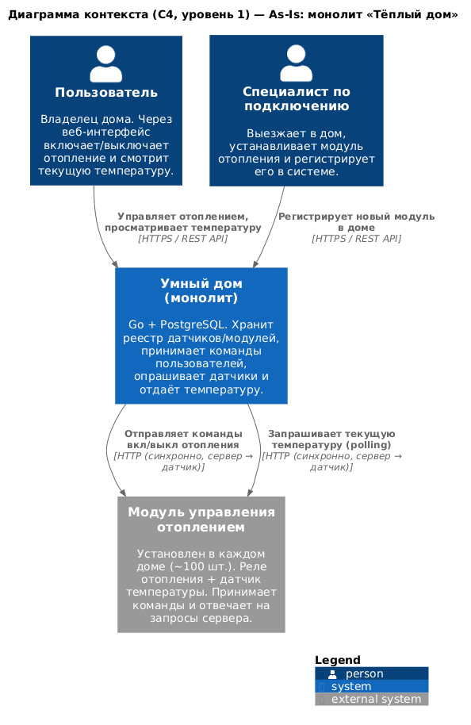

# Project_template

Решение проектной работы первого спринта, «Тёплый дом».

# Задание 1. Анализ и планирование

### 1. Описание функциональности монолитного приложения

**Управление отоплением**

- Пользователь через веб-интерфейс включает и выключает отопление и видит статус модуля (`active` / `inactive`). В коде монолита это пока только запись статуса в БД, вызова самого модуля там нет, так что схему с командами модулю беру из условия.
- Модули хранятся в таблице `sensors`: имя, тип, расположение, значение, единица, статус. Над ней обычный CRUD через `/api/v1/sensors` и отдельный метод для ручного обновления значения и статуса.
- Команды идут только от сервера к устройству.
- Новый дом подключает выездной специалист, сам пользователь устройство добавить не может.

**Мониторинг температуры**

- Температуру дают датчики, встроенные в модуль отопления.
- Опрос синхронный: пришёл запрос пользователя, сервер сходил по HTTP к датчику (`services/temperature_service.go`) и вернул ответ.
- Смотреть можно по датчику или по комнате (`GET /api/v1/sensors/temperature/:location`).
- В базе только последнее значение и время (`value`, `last_updated`), истории нет.

Сейчас это около 100 веб-клиентов и 100 модулей.

### 2. Анализ архитектуры монолитного приложения

Go (Gin, pgx) и PostgreSQL. В базе одна таблица `sensors`, пользователей и домов нет.

Классический монолит: запросы, логика и данные в одном процессе. Слои условные, хендлеры ходят в `db` напрямую, отдельный сервис есть только для запросов к датчикам.

Всё синхронно, цепочка такая: запрос → хендлер → БД → HTTP к датчику → ответ. Очередей и фоновых задач нет, устройство само ничего прислать не может, только сервер его опрашивает. Интеграция с устройствами зашита в код: HTTP к temperature-api и всё, других типов и протоколов нет.

Масштабировать можно только целиком. Деплой один, любая правка означает пересборку и перезапуск всего приложения. Авторизации нет, любой клиент видит датчики всех домов.

При этом для 100 домов монолит нормальный: просто отлаживать, один деплой, транзакции в одной базе. Проблемы начнутся с ростом.

### 3. Определение доменов и границы контекстов

Домен один, удалённое управление умным домом. Контексты внутри него:

| Контекст | Тип | За что отвечает | Сущности |
|---|---|---|---|
| Управление устройствами | core | реестр устройств, типы и возможности, привязка к дому и комнате, состояние, команды | Device, DeviceType, Command |
| Телеметрия | core | приём и хранение показаний, текущие значения и история | Measurement |
| Пользователи и дома | supporting | учётные записи, дома и комнаты, доступ к домам | User, Home, Room |
| Сценарии | core (в целевой системе) | правила «если показание X, то команда Y», расписания | Scenario, Trigger, Action |
| Подключение устройств | supporting | подключение устройств самим пользователем, адаптеры под протоколы партнёров | PairingSession, ProtocolAdapter |
| Уведомления | generic | оповещения: температура вышла за порог, сработал сценарий | Notification |

На `homeId` и `userId` ссылаются все, но владеет ими только контекст пользователей. Показание всегда привязано к устройству, команда сценария тоже, так что телеметрия и сценарии зависят от устройств. Сценарии и уведомления слушают телеметрию. Подключение устройств после сопряжения просто создаёт устройство в модели управления устройствами.

В монолите из этого есть только устройства и телеметрия, и они слиты в один `Sensor`: это и устройство (тип, место, статус), и его последнее показание. Так что при разделении первым делом их надо развести.

### 4. Проблемы монолитного решения

- Устройство и показания в одной таблице: историю хранить негде, а реле ворот или свет без показаний в эту модель не ложатся.
- `GET /api/v1/sensors` внутри запроса пользователя ходит по HTTP к каждому датчику, время ответа растёт линейно. На 100 домах терпимо, на посёлках уже нет.
- Только pull. Датчик не может сам сообщить, что упала температура или открылась дверь, а сценариям и наблюдению это нужно.
- Нет пользователей, домов и авторизации, до SaaS с самообслуживанием далеко.
- Подключение через выездного специалиста, а в целевой системе пользователь должен подключать устройства сам, включая партнёрские.
- В коде есть только тип `temperature`. Свет, ворота и камеры потребуют менять общую модель и передеплоить всё.
- Всё в одном процессе и одном деплое: упал или перезапускается монолит, не работает ни температура, ни управление отоплением.
- Телеметрия при росте даст нагрузки на порядки больше, чем команды, а отдельно её не отмасштабировать.
- По коду: запросы к БД без таймаутов (`context.Background()`), тестов нет.

### 5. Визуализация контекста системы — диаграмма С4

[schemas/task1/c4-context.puml](schemas/task1/c4-context.puml)



Вся система здесь один монолит. С ним работают пользователь (включает отопление, смотрит температуру), специалист по подключению (регистрирует модуль, раз пользователь не может) и модуль отопления в доме: реле и датчик, которым монолит шлёт команды и которые сам опрашивает. PostgreSQL на этом уровне не показываю, он появится на диаграмме контейнеров.

# Задание 2. Проектирование микросервисной архитектуры

В этом задании вам нужно предоставить только диаграммы в модели C4. Мы не просим вас отдельно описывать получившиеся микросервисы и то, как вы определили взаимодействия между компонентами To-Be системы. Если вы правильно подготовите диаграммы C4, они и так это покажут.

**Диаграмма контейнеров (Containers)**

Добавьте диаграмму.

**Диаграмма компонентов (Components)**

Добавьте диаграмму для каждого из выделенных микросервисов.

**Диаграмма кода (Code)**

Добавьте одну диаграмму или несколько.

# Задание 3. Разработка ER-диаграммы

Добавьте сюда ER-диаграмму. Она должна отражать ключевые сущности системы, их атрибуты и тип связей между ними.

# Задание 4. Создание и документирование API

### 1. Тип API

Укажите, какой тип API вы будете использовать для взаимодействия микросервисов. Объясните своё решение.

### 2. Документация API

Здесь приложите ссылки на документацию API для микросервисов, которые вы спроектировали в первой части проектной работы. Для документирования используйте Swagger/OpenAPI или AsyncAPI.

# Задание 5. Работа с docker и docker-compose

Перейдите в apps.

Там находится приложение-монолит для работы с датчиками температуры. В README.md описано как запустить решение.

Вам нужно:

1) сделать простое приложение temperature-api на любом удобном для вас языке программирования, которое при запросе /temperature?location= будет отдавать рандомное значение температуры.

Locations - название комнаты, sensorId - идентификатор названия комнаты

```
	// If no location is provided, use a default based on sensor ID
	if location == "" {
		switch sensorID {
		case "1":
			location = "Living Room"
		case "2":
			location = "Bedroom"
		case "3":
			location = "Kitchen"
		default:
			location = "Unknown"
		}
	}

	// If no sensor ID is provided, generate one based on location
	if sensorID == "" {
		switch location {
		case "Living Room":
			sensorID = "1"
		case "Bedroom":
			sensorID = "2"
		case "Kitchen":
			sensorID = "3"
		default:
			sensorID = "0"
		}
	}
```

2) Приложение следует упаковать в Docker и добавить в docker-compose. Порт по умолчанию должен быть 8081

3) Кроме того для smart_home приложения требуется база данных - добавьте в docker-compose файл настройки для запуска postgres с указанием скрипта инициализации ./smart_home/init.sql

Для проверки можно использовать Postman коллекцию smarthome-api.postman_collection.json и вызвать:

- Create Sensor
- Get All Sensors

Должно при каждом вызове отображаться разное значение температуры

Ревьюер будет проверять точно так же.


# **Задание 6. Разработка MVP**

Необходимо создать новые микросервисы и обеспечить их интеграции с существующим монолитом для плавного перехода к микросервисной архитектуре. 

### **Что нужно сделать**

1. Создайте новые микросервисы для управления телеметрией и устройствами (с простейшей логикой), которые будут интегрированы с существующим монолитным приложением. Каждый микросервис на своем ООП языке.
2. Обеспечьте взаимодействие между микросервисами и монолитом (при желании с помощью брокера сообщений), чтобы постепенно перенести функциональность из монолита в микросервисы. 

В результате у вас должны быть созданы Dockerfiles и docker-compose для запуска микросервисов. 