# Project_template

Решение проектной работы первого спринта, «Тёплый дом».

# Задание 1. Анализ и планирование

### 1. Описание функциональности монолитного приложения

**Управление отоплением**

- Пользователь через веб-интерфейс включает и выключает отопление и видит статус модуля (`active` / `inactive`). В коде монолита это пока только запись статуса в БД, вызова самого модуля там нет, так что схему с командами модулю беру из условия.
- Модули хранятся в таблице `sensors`: имя, тип, расположение, значение, единица, статус. Над ней обычный CRUD через `/api/v1/sensors` и отдельный метод для ручного обновления значения и статуса.
- Команды идут только от сервера к устройству.
- Новый дом подключает выездной специалист, сам пользователь устройство добавить не может.

**Мониторинг температуры**

- Температуру дают датчики, встроенные в модуль отопления.
- Опрос синхронный: пришёл запрос пользователя, сервер сходил по HTTP к датчику (`services/temperature_service.go`) и вернул ответ.
- Смотреть можно по датчику или по комнате (`GET /api/v1/sensors/temperature/:location`).
- В базе только последнее значение и время (`value`, `last_updated`), истории нет.

Сейчас это около 100 веб-клиентов и 100 модулей.

### 2. Анализ архитектуры монолитного приложения

Go (Gin, pgx) и PostgreSQL. В базе одна таблица `sensors`, пользователей и домов нет.

Классический монолит: запросы, логика и данные в одном процессе. Слои условные, хендлеры ходят в `db` напрямую, отдельный сервис есть только для запросов к датчикам.

Всё синхронно, цепочка такая: запрос → хендлер → БД → HTTP к датчику → ответ. Очередей и фоновых задач нет, устройство само ничего прислать не может, только сервер его опрашивает. Интеграция с устройствами зашита в код: HTTP к temperature-api и всё, других типов и протоколов нет.

Масштабировать можно только целиком. Деплой один, любая правка означает пересборку и перезапуск всего приложения. Авторизации нет, любой клиент видит датчики всех домов.

При этом для 100 домов монолит нормальный: просто отлаживать, один деплой, транзакции в одной базе. Проблемы начнутся с ростом.

### 3. Определение доменов и границы контекстов

Домен один, удалённое управление умным домом. Контексты внутри него:

| Контекст | Тип | За что отвечает | Сущности |
|---|---|---|---|
| Управление устройствами | core | реестр устройств, типы и возможности, привязка к дому и комнате, состояние, команды | Device, DeviceType, Command |
| Телеметрия | core | приём и хранение показаний, текущие значения и история | Measurement |
| Пользователи и дома | supporting | учётные записи, дома и комнаты, доступ к домам | User, Home, Room |
| Сценарии | core (в целевой системе) | правила «если показание X, то команда Y», расписания | Scenario, Trigger, Action |
| Подключение устройств | supporting | подключение устройств самим пользователем, адаптеры под протоколы партнёров | PairingSession, ProtocolAdapter |
| Уведомления | generic | оповещения: температура вышла за порог, сработал сценарий | Notification |

На `homeId` и `userId` ссылаются все, но владеет ими только контекст пользователей. Показание всегда привязано к устройству, команда сценария тоже, так что телеметрия и сценарии зависят от устройств. Сценарии и уведомления слушают телеметрию. Подключение устройств после сопряжения просто создаёт устройство в модели управления устройствами.

В монолите из этого есть только устройства и телеметрия, и они слиты в один `Sensor`: это и устройство (тип, место, статус), и его последнее показание. Так что при разделении первым делом их надо развести.

### 4. Проблемы монолитного решения

- Устройство и показания в одной таблице: историю хранить негде, а реле ворот или свет без показаний в эту модель не ложатся.
- `GET /api/v1/sensors` внутри запроса пользователя ходит по HTTP к каждому датчику, время ответа растёт линейно. На 100 домах терпимо, на посёлках уже нет.
- Только pull. Датчик не может сам сообщить, что упала температура или открылась дверь, а сценариям и наблюдению это нужно.
- Нет пользователей, домов и авторизации, до SaaS с самообслуживанием далеко.
- Подключение через выездного специалиста, а в целевой системе пользователь должен подключать устройства сам, включая партнёрские.
- В коде есть только тип `temperature`. Свет, ворота и камеры потребуют менять общую модель и передеплоить всё.
- Всё в одном процессе и одном деплое: упал или перезапускается монолит, не работает ни температура, ни управление отоплением.
- Телеметрия при росте даст нагрузки на порядки больше, чем команды, а отдельно её не отмасштабировать.
- По коду: запросы к БД без таймаутов (`context.Background()`), тестов нет.

### 5. Визуализация контекста системы — диаграмма С4

[schemas/task1/c4-context.puml](schemas/task1/c4-context.puml)


Вся система здесь один монолит. С ним работают пользователь (включает отопление, смотрит температуру), специалист по подключению (регистрирует модуль, раз пользователь не может) и модуль отопления в доме: реле и датчик, которым монолит шлёт команды и которые сам опрашивает. PostgreSQL на этом уровне не показываю, он появится на диаграмме контейнеров.

# Задание 2. Проектирование микросервисной архитектуры

Сервисы выделял по контекстам из первого задания, у каждого своя база. Подключение устройств стало шлюзом устройств: кроме регистрации там вся связь с железом, MQTT, адаптеры протоколов и приём данных.

Что решил:

- Снаружи всё идёт через API Gateway, он же проверяет токен, дальше REST к нужному сервису.
- Между сервисами события в Kafka (`telemetry.measured`, `device.commands`, `device.state`). Сценарии и уведомления подписываются на них и никого не опрашивают, а новый сервис добавляется без правок в старых.
- Устройства сами шлют показания и состояние по MQTT, синхронного опроса из запроса пользователя больше нет.
- Новые типы устройств и старые модули отопления, которые умеют только HTTP, подключаются адаптерами в шлюзе.

Монолита в целевой схеме нет. Переходить к ней надо постепенно (strangler fig), промежуточный этап с монолитом показан в шестом задании.

Отдельных сервисов под отопление, свет и ворота не делал: для системы это одно и то же, устройство с типом, командами и состоянием. Новый вид устройств добавляется записью в справочнике типов и адаптером в шлюзе, так же подключаются и датчики партнёров, о которых сейчас ещё ничего не известно: пишется адаптер, остальные сервисы не меняются. Исключение камеры. Видео через Kafka гонять незачем, поэтому есть медиасервер: камера отдаёт ему RTSP, браузер забирает поток у него. В реестре устройств камеры при этом есть, как и всё остальное.

Доступ к дому проверяется так: сервис пользователей при входе кладёт в JWT id домов пользователя, API Gateway передаёт их сервисам в `X-House-Ids`, а сервис сверяет с ними дом устройства. Владелец у дома один, отдельной таблицы доступов пока нет.

План перехода. Сервисов шесть, разработчиков пять, поэтому по шагам:

1. Устройства и телеметрия рядом с монолитом (это MVP из шестого задания). Монолит публикует события о датчиках и показаниях, команды старым модулям сервис устройств пока шлёт через монолит.
2. Пользователи и дома, API Gateway, авторизация. Веб-клиент переключается на новые API, монолит остаётся только драйвером старых модулей.
3. Шлюз устройств и MQTT. Новые устройства подключаются только через него, старые модули отопления переводятся на HTTP-адаптер шлюза, `LegacyHeatingSender` удаляется.
4. Оставшиеся датчики из таблицы `sensors` переносятся в сервис устройств, монолит выключается.
5. Сценарии и уведомления, они ни от чего в монолите не зависят.

**Диаграмма контейнеров (Containers)**

As-Is: [schemas/task2/c4-container-as-is.puml](schemas/task2/c4-container-as-is.puml)

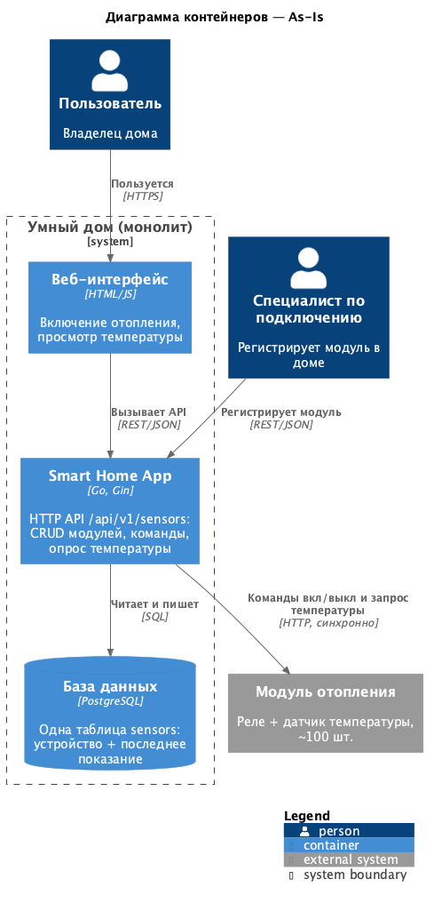

To-Be: [schemas/task2/c4-container-to-be.puml](schemas/task2/c4-container-to-be.puml)

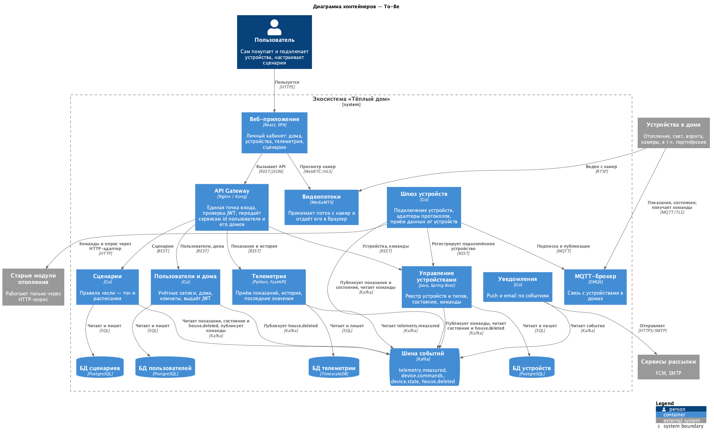

**Диаграмма компонентов (Components)**

Управление устройствами: [schemas/task2/c4-component-devices.puml](schemas/task2/c4-component-devices.puml)

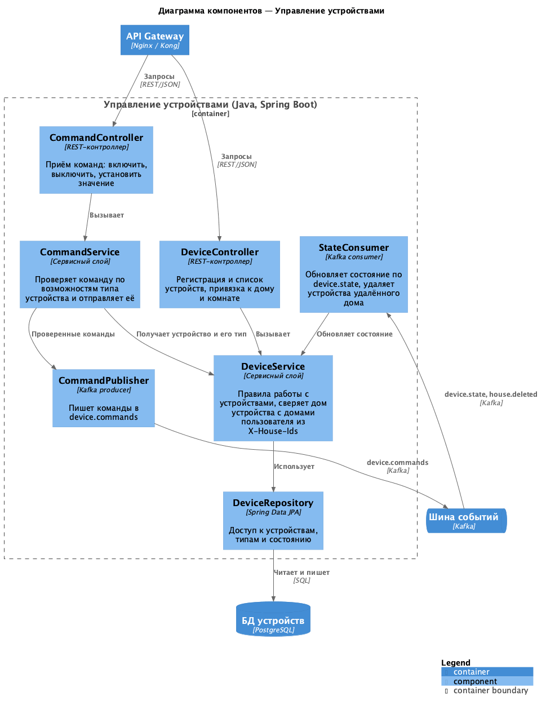

Телеметрия: [schemas/task2/c4-component-telemetry.puml](schemas/task2/c4-component-telemetry.puml)

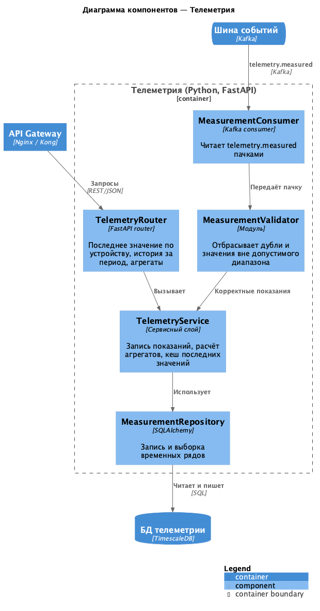

Шлюз устройств: [schemas/task2/c4-component-device-gateway.puml](schemas/task2/c4-component-device-gateway.puml)

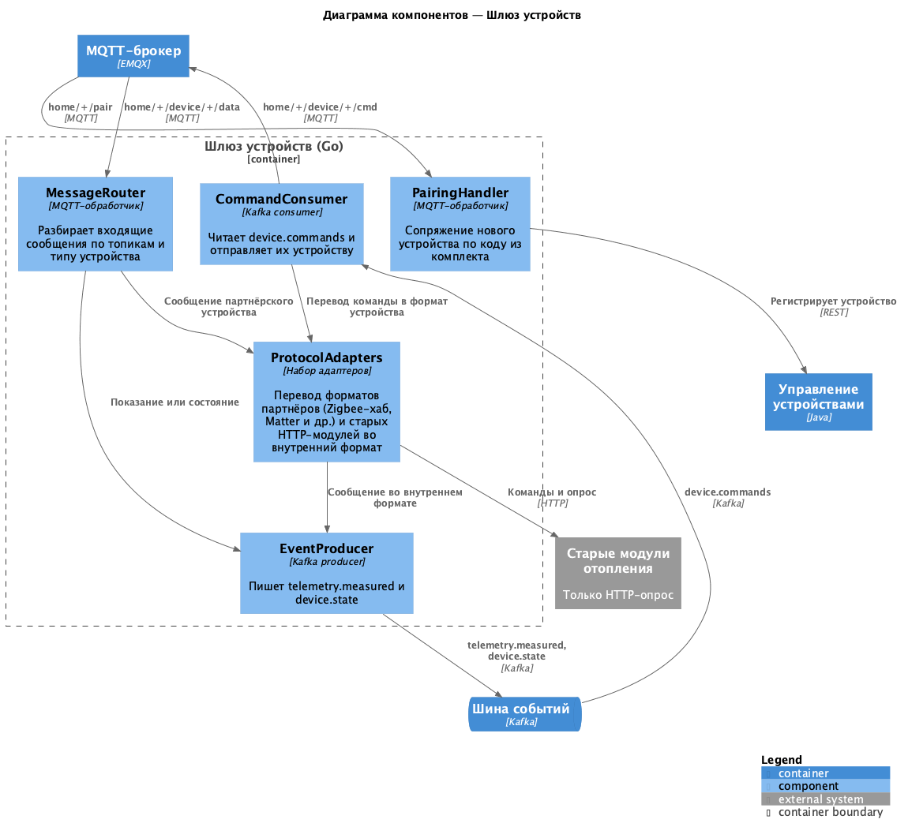

Пользователи и дома: [schemas/task2/c4-component-users.puml](schemas/task2/c4-component-users.puml)

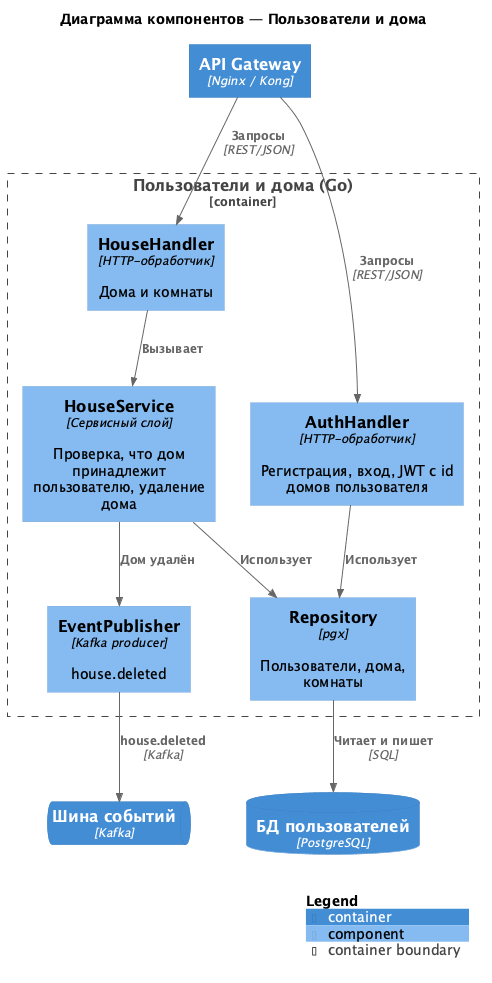

Сценарии: [schemas/task2/c4-component-scenarios.puml](schemas/task2/c4-component-scenarios.puml)

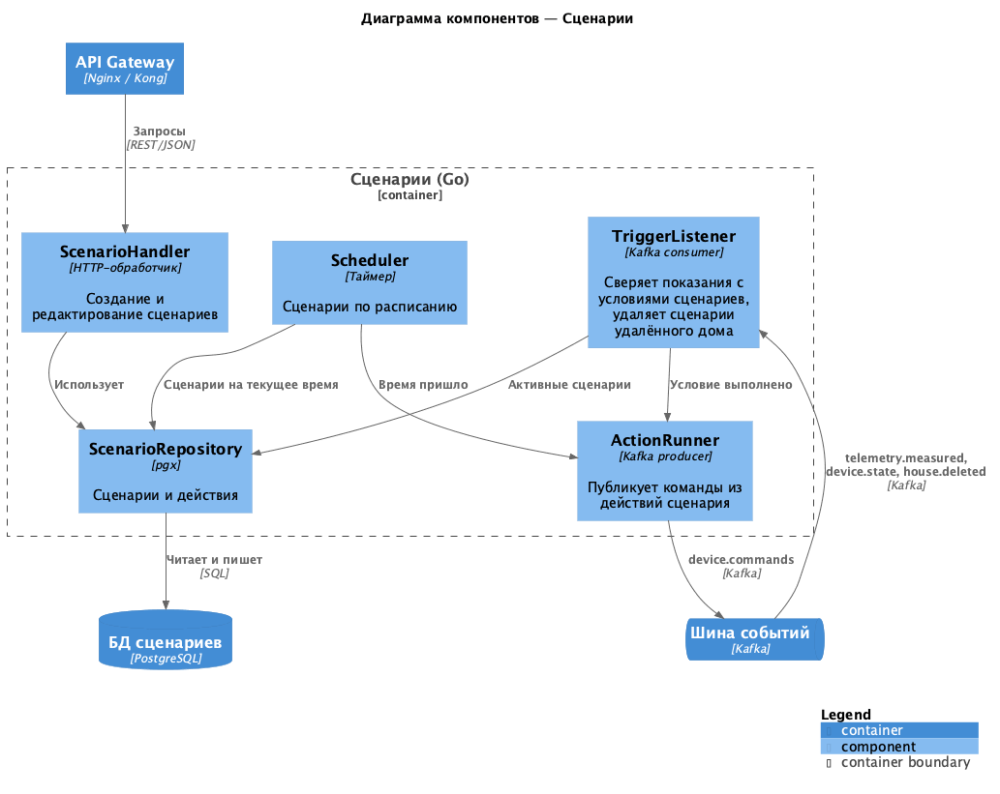

Уведомления: [schemas/task2/c4-component-notifications.puml](schemas/task2/c4-component-notifications.puml)

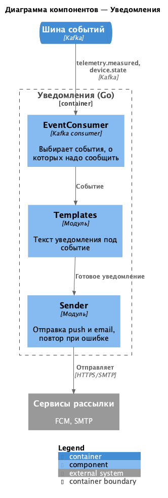

**Диаграмма кода (Code)**

Для кода взял модель устройства и отправку команд. Отправка спрятана за `CommandSender`: в целевой схеме команда уходит в Kafka, а пока идёт миграция, старым модулям отопления через монолит (`LegacyHeatingSender`, он работает в MVP). Когда модули переедут на шлюз, класс удаляется.

[schemas/task2/code-devices.puml](schemas/task2/code-devices.puml)

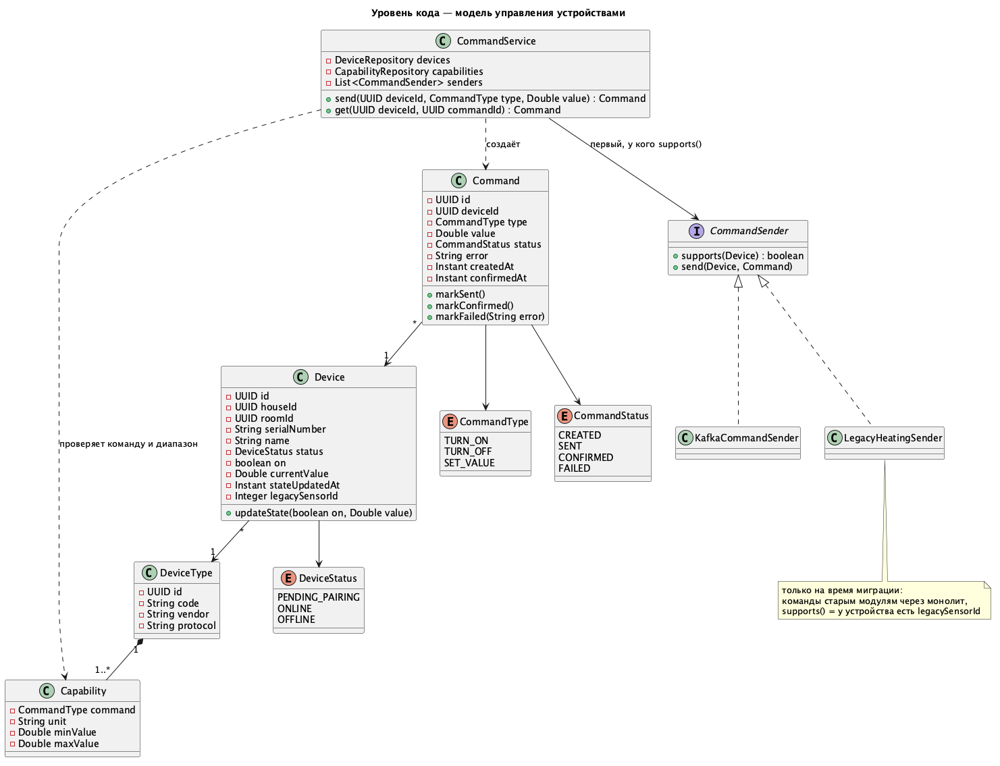

Включение отопления по шагам: [schemas/task2/dynamic-heating-command.puml](schemas/task2/dynamic-heating-command.puml)

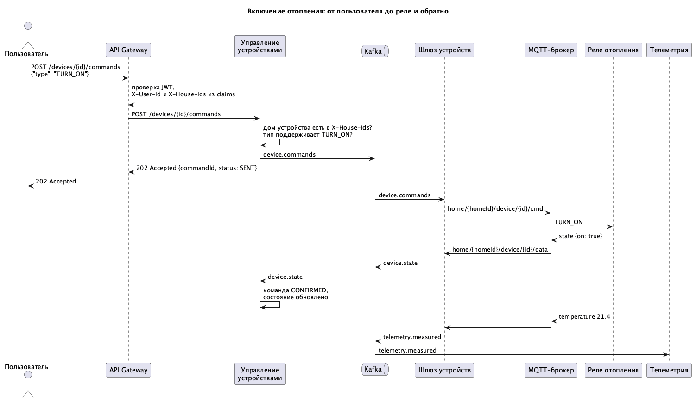

# Задание 3. Разработка ER-диаграммы

[schemas/task3/er-diagram.puml](schemas/task3/er-diagram.puml)

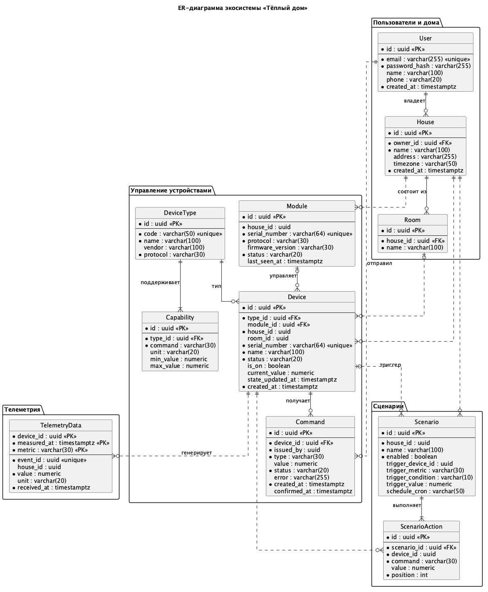

Сущности сгруппированы по сервисам, у каждого своя база. Сплошная линия на диаграмме это внешний ключ внутри одной базы, пунктир это ссылка по id в чужой сервис, без FK. Такие ссылки держатся на событиях: удалили дом, сервисы устройств и сценариев получили событие и почистили своё.

- **User**: пользователь, логин по email.
- **House**: дом, владелец один (`owner_id`). **Room**: комната, к ней привязываются устройства, например чтобы включать свет по комнатам.
- **DeviceType**: тип устройства (термостат, реле света, привод ворот, камера), протокол и производитель. **Capability**: какие команды принимает тип и в каком диапазоне. По ней команда проверяется до отправки.
- **Module**: хаб или контроллер из комплекта, к нему подключаются устройства. Устройство может подключаться к шлюзу и напрямую, поэтому `module_id` необязательный.
- **Device**: устройство в доме. Текущее состояние (`is_on`, `current_value`) хранится прямо в нём.
- **Command**: команды устройству со статусом. Нужна для отладки и чтобы показать пользователю, что команда не дошла.
- **TelemetryData**: показания, ключ составной (`device_id`, `measured_at`, `metric`), `event_id` для отсева дублей, `house_id` для проверки доступа. Записей много, выборки идут по устройству и периоду, поэтому гипертаблица TimescaleDB.
- **Scenario** и **ScenarioAction**: сценарий с условием (показание или расписание) и его действия по порядку.

Связи все один ко многим: User → House (владелец), House → Room / Device / Module, DeviceType → Device и Capability (у типа минимум одна возможность), Module → Device (со стороны устройства необязательная), Device → Command и TelemetryData, Scenario → ScenarioAction (хотя бы одно действие).

# Задание 4. Создание и документирование API

### 1. Тип API

REST там, где клиенту нужен ответ сразу: получить устройство, отправить команду, посмотреть историю температуры.

События в Kafka (AsyncAPI) между сервисами и для всего, что идёт от устройств. Показания и смену состояния слушают сразу несколько сервисов. Будь это синхронные вызовы, отправитель знал бы про всех получателей и ждал каждого, а так он публикует событие, и всё. Заодно Kafka сглаживает пики: если телеметрия ненадолго упала, показания дочитаются после подъёма.

Поэтому команда устройству возвращает `202 Accepted`: она ушла в шину, а подтверждение от реле придёт позже событием `device.state`. Статус команды можно спросить через `GET /devices/{id}/commands/{commandId}`.

### 2. Документация API

[schemas/task4/devices-openapi.yaml](schemas/task4/devices-openapi.yaml), управление устройствами:
- `GET /devices`: устройства домов пользователя;
- `POST /devices`: регистрация устройства, его вызывает шлюз после сопряжения;
- `GET /devices/{deviceId}`: устройство и его текущее состояние;
- `PUT /devices/{deviceId}/state`: обновление состояния (для старых модулей и монолита);
- `POST /devices/{deviceId}/commands`: отправка команды;
- `GET /devices/{deviceId}/commands/{commandId}`: статус команды.

[schemas/task4/telemetry-openapi.yaml](schemas/task4/telemetry-openapi.yaml), телеметрия:
- `GET /telemetry/devices/{deviceId}/latest`: последние показания;
- `GET /telemetry/devices/{deviceId}`: история за период с усреднением по интервалам;
- `POST /measurements`: запись показания по HTTP, временно для монолита.

[schemas/task4/events-asyncapi.yaml](schemas/task4/events-asyncapi.yaml): события `telemetry.measured`, `device.commands`, `device.state`, `house.deleted` и `legacy.sensor.registered` на время миграции.

Открываются в [Swagger Editor](https://editor.swagger.io/) и [AsyncAPI Studio](https://studio.asyncapi.com/). У эндпоинтов есть тела запросов и ответов, коды и примеры. Авторизация по JWT: его проверяет API Gateway и передаёт сервису id пользователя в `X-User-Id` и id его домов в `X-House-Ids`.

# Задание 5. Работа с docker и docker-compose

Перейдите в apps.

Там находится приложение-монолит для работы с датчиками температуры. В README.md описано как запустить решение.

Вам нужно:

1) сделать простое приложение temperature-api на любом удобном для вас языке программирования, которое при запросе /temperature?location= будет отдавать рандомное значение температуры.

Locations - название комнаты, sensorId - идентификатор названия комнаты

```
	// If no location is provided, use a default based on sensor ID
	if location == "" {
		switch sensorID {
		case "1":
			location = "Living Room"
		case "2":
			location = "Bedroom"
		case "3":
			location = "Kitchen"
		default:
			location = "Unknown"
		}
	}

	// If no sensor ID is provided, generate one based on location
	if sensorID == "" {
		switch location {
		case "Living Room":
			sensorID = "1"
		case "Bedroom":
			sensorID = "2"
		case "Kitchen":
			sensorID = "3"
		default:
			sensorID = "0"
		}
	}
```

2) Приложение следует упаковать в Docker и добавить в docker-compose. Порт по умолчанию должен быть 8081

3) Кроме того для smart_home приложения требуется база данных - добавьте в docker-compose файл настройки для запуска postgres с указанием скрипта инициализации ./smart_home/init.sql

Для проверки можно использовать Postman коллекцию smarthome-api.postman_collection.json и вызвать:

- Create Sensor
- Get All Sensors

Должно при каждом вызове отображаться разное значение температуры

Ревьюер будет проверять точно так же.


# **Задание 6. Разработка MVP**

Необходимо создать новые микросервисы и обеспечить их интеграции с существующим монолитом для плавного перехода к микросервисной архитектуре. 

### **Что нужно сделать**

1. Создайте новые микросервисы для управления телеметрией и устройствами (с простейшей логикой), которые будут интегрированы с существующим монолитным приложением. Каждый микросервис на своем ООП языке.
2. Обеспечьте взаимодействие между микросервисами и монолитом (при желании с помощью брокера сообщений), чтобы постепенно перенести функциональность из монолита в микросервисы. 

В результате у вас должны быть созданы Dockerfiles и docker-compose для запуска микросервисов. 